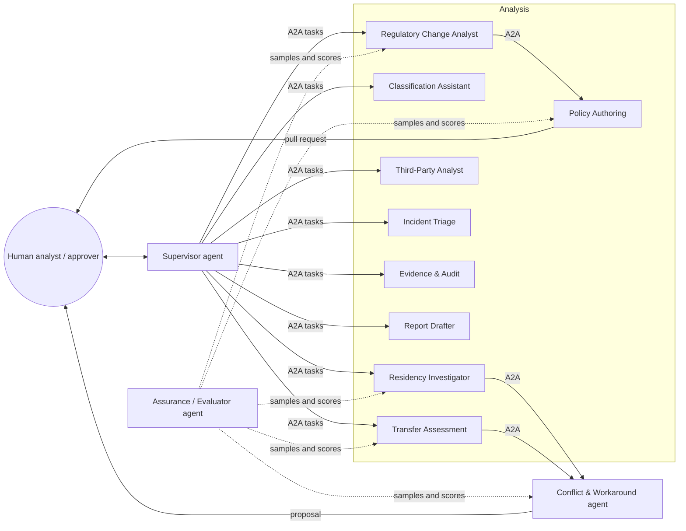
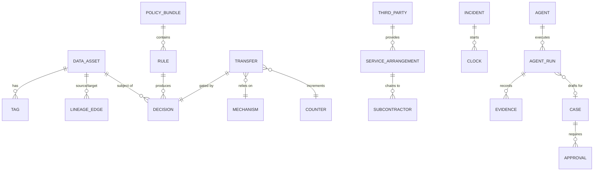
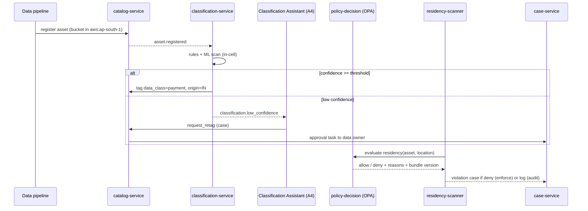

# Regulatory Control Plane (RCP)
## Microservices and AI Agents for Global Banking Compliance Analysis and Remediation

| Field | Value |
|---|---|
| Document type | Solution architecture and build specification |
| Version | 0.9 (POC design) |
| Date | October 2026 |
| Companion documents | *Global Regulatory Evaluation & POC Recommendation* (.docx), *Global Regulatory Matrix & POC Scoring* (.xlsx) |
| Scope | POC: EU, India, Singapore live cells; Mainland China simulated cell; Markets & Investments and Payments segments; two cloud providers |
| Status | Draft for architecture review |

> **Not legal advice.** Every jurisdictional rule encoded in this platform must be confirmed by legal and compliance before it is promoted to an enforcing policy pack. Thresholds and dates quoted here are as researched in October 2026 and are configuration, not code.

---

## Table of contents

1. [Purpose and problem statement](#1-purpose-and-problem-statement)
2. [Design principles](#2-design-principles)
3. [Research findings that shape the design](#3-research-findings-that-shape-the-design)
4. [Architecture overview](#4-architecture-overview)
5. [Microservices catalogue](#5-microservices-catalogue)
6. [Event backbone and contracts](#6-event-backbone-and-contracts)
7. [Agent layer: analysis and workaround agents](#7-agent-layer-analysis-and-workaround-agents)
8. [Agent runtime, protocols and model access](#8-agent-runtime-protocols-and-model-access)
9. [Agent security and governance](#9-agent-security-and-governance)
10. [Observability, records and audit](#10-observability-records-and-audit)
11. [Core data model](#11-core-data-model)
12. [Key end-to-end flows](#12-key-end-to-end-flows)
13. [Policy-as-code design](#13-policy-as-code-design)
14. [Deployment topology](#14-deployment-topology)
15. [Repository structure](#15-repository-structure)
16. [Technology stack and alternatives](#16-technology-stack-and-alternatives)
17. [Testing and agent evaluation](#17-testing-and-agent-evaluation)
18. [POC delivery plan and success metrics](#18-poc-delivery-plan-and-success-metrics)
19. [Risks, open decisions and assumptions](#19-risks-open-decisions-and-assumptions)
20. [References](#20-references)

---

## 1. Purpose and problem statement

The bank operates across multiple **domains** (markets, investment and wealth, payments and transaction banking, insurance), multiple **clouds** (AWS, Azure, GCP) and multiple **jurisdictions**, each with its own standards. The regulatory evaluation concluded that regulation converges on eight control families:

1. Data residency and cross-border transfer
2. Privacy, consent and data classification
3. Operational resilience and ICT incident reporting
4. Third-party and cloud risk
5. Conduct and transaction reporting
6. Prudential capital (Basel for banking, solvency regimes for insurance)
7. AI and model governance
8. Financial crime (AML, KYC, sanctions)

Its recommendation was to build a **jurisdiction-aware regulatory control plane**, not one application per regulation. This document specifies that platform as:

- a **deterministic core** of microservices that tag data, enforce policy, gate cross-border transfers, keep registers, collect evidence and generate reports, and
- an **agent layer** that performs the analysis that does not reduce to rules: interpreting regulatory change, investigating violations, assessing proposed transfers, extracting contract clauses, triaging incidents, and proposing **compliant workarounds** when two obligations collide.

### 1.1 What "workaround" means in this platform

A workaround here is **a compliant alternative way to achieve a business outcome when the direct route is blocked by a rule**. Typical examples are aggregating instead of exporting raw records, pseudonymising before transfer, processing in-region and exporting only results, or using a federated query.

A workaround is **never** a way to avoid, disguise or defeat a control. Agents may only select from a catalogue of approved workaround patterns (Section 7.4). Any novel proposal is routed to legal review and cannot be executed by an agent.

### 1.2 Goals

| ID | Goal | Measured by |
|---|---|---|
| G1 | Every regulated data asset is tagged with class, segment, owner, legal entity and jurisdiction of origin | Classification coverage % |
| G2 | No regulated data is stored or moved outside permitted regions without a recorded legal mechanism | Residency conformance %, unmechanised transfers blocked |
| G3 | One master third-party register exports to DORA, CPS 230 and MAS formats | Export validation pass rate |
| G4 | Regulatory reports are generated from evidence and are reproducible | Report regeneration diff = 0 |
| G5 | Analysis work (change impact, investigations, transfer assessments) is accelerated by agents without agents taking regulatory decisions | Analyst hours saved; 0 agent-executed regulatory actions without approval |
| G6 | Every agent action is attributable, explainable and retained as a record | Trace completeness % |

### 1.3 Non-goals for the POC

The following are out of scope for the POC:

- A live Mainland China deployment (simulated with synthetic data).
- Insurance solvency calculations.
- Production trade-reporting submission to regulators (reports are generated, not filed).
- Replacing existing AML or transaction-monitoring engines. The platform consumes their outputs.

---

## 2. Design principles

**P1 — Deterministic core, advisory agents.** Anything with regulatory effect (allow or deny, mechanism recorded, report figure, notification sent) is produced by a deterministic, tested service. Agents analyse, draft, explain and recommend. Agents never hold the pen on a decision.

**P2 — Policy is code, and code is reviewed.** Jurisdictional rules live in versioned policy packs with unit tests. An agent can draft a policy change. Only a human-approved merge can deploy one.

**P3 — Data stays in its cell, and so do agents.** An agent operating on India data runs in the India cell, calls an in-region model endpoint and sees only India tools. Global agents see only aggregates and metadata.

**P4 — Least privilege per agent identity.** Each agent has its own workload identity, a tool allowlist and read-only access by default. Write tools are wrapped in workflows with approval steps.

**P5 — Everything is evidence.** Every decision, agent run, tool call, approval and report has an immutable, hash-chained record with a retention class.

**P6 — Configuration over hard-coding.** Thresholds (for example China transfer volumes), deadlines and region allowlists are data in policy bundles, so a regulatory change does not need a code release.

**P7 — Protocol-standard integration.** Tools are exposed via MCP, and agent-to-agent delegation uses A2A. This avoids lock-in to any single agent framework.

**P8 — Observe first, then enforce.** New policies run in *audit mode* (log-only) before *enforce mode*, so false positives do not break production flows.

---

## 3. Research findings that shape the design

| Finding (Oct 2026) | Design consequence |
|---|---|
| **MCP** is the de facto standard for agent-to-tool access. It was donated to the Linux Foundation's Agentic AI Foundation (launched December 2025). A mid-2026 spec revision reportedly made the core stateless and formalised extensions such as Tasks. | Each microservice exposes an MCP server for its agent-safe operations. Pin the MCP spec version per release and re-test on upgrades. |
| **A2A** reached v1.0 in April 2026 with signed Agent Cards. IBM's ACP merged into it. It is under Linux Foundation governance (reports differ on the exact umbrella). | Agent-to-agent delegation uses A2A. Only agents with signed cards from our registry are trusted. |
| **OPA** remains a CNCF-graduated project. Its original maintainers moved to Apple in August 2025, and Styra's commercial products are being sunset into the community project. | Use open-source OPA with Rego. Avoid dependencies on Styra DAS or Enterprise OPA. Keep Cedar as an evaluated alternative for authorisation-only decisions. |
| **OpenTelemetry GenAI semantic conventions** (spans for `invoke_agent`, `chat`, `execute_tool`, MCP calls) are still at *Development* status. In June 2026 they moved to a separate repository with no tagged release. | Instrument to the conventions but pin the schema version. Map to our own stable internal audit schema so dashboards and records survive attribute renames. |
| **OWASP Top 10 for Agentic Applications** (December 2025) catalogues agent-specific risks. Examples: ASI01 goal hijack, ASI02 tool misuse, ASI03 identity and privilege abuse, ASI04 agentic supply chain (poisoned MCP or A2A components). | Section 9 maps every ASI risk to a concrete control. |
| **FINRA 2026 oversight report** treats agentic AI as a supervisory priority. It points firms to human-in-the-loop checkpoints, limited system access, behavioural guardrails and traceability of agent actions. | Autonomy levels and mandatory checkpoints (Section 7.2), plus full agent tracing (Section 10). |
| **MAS** consulted on Guidelines on AI Risk Management (November 2025 to January 2026). **US Treasury** published a Financial Services AI Risk Management Framework (February 2026). | Agents themselves are registered in the model inventory service with risk tier, owner and lifecycle evidence. |
| **SEC 17a-4 / FINRA 4511**: agent-generated records in regulated workflows may themselves be books and records. Six-year retention generally applies under 4511. | Agent traces in regulated workflows use the WORM evidence store with retention class `BR-6Y` (confirm with counsel per record type). |
| **DORA** applies to ICT services supporting financial entities, including agent tooling that touches production. The EU **AI Act** high-risk obligations moved to 2 December 2027. | Model providers and agent tooling vendors are entries in the third-party register. The platform's own agents are classified (expected: not Annex III, since they are internal compliance support, but confirm). |

---

## 4. Architecture overview

### 4.1 Logical view

```mermaid
flowchart TB
  subgraph GLOBAL["Global control plane (metadata and aggregates only)"]
    PPS[policy-pack-service]
    RCS[reg-change-service]
    TPR[third-party-register-service]
    MIS[model-inventory-service]
    RPT[report-service]
    DASH[dashboard-bff]
    ORCH[Supervisor agent]
    GAG[Global agents: Reg Change Analyst, Third-Party Analyst, Report Drafter]
  end

  subgraph CELL_EU["EU cell (Cloud A + Cloud B)"]
    CAT1[catalog / classification]
    PDP1[policy-decision (OPA)]
    RES1[residency-scanner]
    EVD1[evidence-service WORM]
    INC1[incident-clock]
    AG1[Cell agents]
  end

  subgraph CELL_IN["India cell"]
    CAT2[catalog / classification]
    PDP2[policy-decision (OPA)]
    RES2[residency-scanner]
    EVD2[evidence-service WORM]
    AG2[Cell agents]
  end

  subgraph CELL_SG["Singapore cell"]
    CAT3[catalog / classification]
    PDP3[policy-decision (OPA)]
    EVD3[evidence-service WORM]
    AG3[Cell agents]
  end

  subgraph CELL_CN["China cell (SIMULATED, synthetic data)"]
    CAT4[catalog / classification]
    PDP4[policy-decision (OPA)]
    CNT[volume counters]
  end

  TGW{{transfer-gateway: the ONLY path between cells}}

  CELL_EU <--> TGW
  CELL_IN <--> TGW
  CELL_SG <--> TGW
  CELL_CN <--> TGW
  TGW <--> GLOBAL
  PPS -- signed policy bundles --> PDP1 & PDP2 & PDP3 & PDP4
```

### 4.2 Planes

| Plane | Responsibility | Where it runs |
|---|---|---|
| **Control plane** | Policy authoring and distribution, registers, reporting, global analytics, agent supervision | Global (EU region by default; choose based on group HQ and counsel advice) |
| **Data plane (cells)** | Holds regulated data; classification, enforcement, scanning, evidence, incident clocks, cell agents | One cell per localisation regime, spread across ≥2 clouds where resilience requires |
| **Transfer plane** | Mediates every cross-cell movement; checks policy; records the mechanism; counts volumes; applies workaround transforms (aggregate, pseudonymise) | Deployed at each cell boundary with a global coordinator |
| **Agent plane** | Agent runtime, MCP gateway, A2A registry, model gateway | Global agents in the control plane; cell agents inside each cell |

### 4.3 Cell rules

1. **Keys stay in the cell.** Raw regulated data is encrypted with keys held in the cell's region (cloud KMS or HSM).
2. **Logs stay in the cell.** Cell logs and evidence remain in-cell. Only hashes and aggregates replicate to global.
3. **Agents stay in the cell.** A cell agent's model calls go to a model endpoint in an approved region for that cell's data class. If none exists, the agent runs on metadata only.
4. **The China cell is a simulation.** For the POC it runs in a non-China region on synthetic data. It proves the rule logic (routes, counters, important-data blocks, the DSL Art. 36 disclosure gate) without moving real data.

---

## 5. Microservices catalogue

Each service owns its data store, publishes CloudEvents to the event backbone, exposes a REST/gRPC API for services, and exposes a **curated MCP server** for agents. The MCP surface is narrower than the API: read operations, plus write operations only as "request" calls that start an approval workflow.

### 5.1 Data and classification domain

| Service | Responsibility | Owns | Key APIs / events | Scope |
|---|---|---|---|---|
| `catalog-service` | Registry of data assets (datasets, tables, buckets, topics) with tags: `data_class`, `segment`, `owner`, `legal_entity`, `origin_jurisdiction`, `retention_class` | Asset graph | `asset.registered`, `asset.tagged`; `GET /assets/{id}` | Per cell + global metadata index |
| `classification-service` | Detects PII, sensitive PI, payment data, trade data, health data and "important data" candidates using rules, dictionaries and ML. Emits confidence scores | Classifier configs, results | `classification.completed`, `classification.low_confidence` | Per cell |
| `lineage-service` | Captures dataset-to-dataset lineage (OpenLineage) for BCBS 239 and report reproducibility | Lineage graph | `lineage.updated` | Per cell + global aggregate |

### 5.2 Policy domain

| Service | Responsibility | Owns | Key APIs / events | Scope |
|---|---|---|---|---|
| `policy-pack-service` | Authoring, versioning, testing, signing and distribution of jurisdiction policy packs (Rego + data). Promotes audit → enforce | Git-backed packs, bundle registry | `policy.bundle.published`, `policy.mode.changed` | Global |
| `policy-decision-service` | OPA PDP. Evaluates residency, transfer, retention and access decisions. Returns allow/deny with reasons and the pack version | Decision logs | `decision.made`; `POST /v1/data/{pkg}` | Per cell (sidecar + central) |
| `mechanism-registry` | Legal transfer mechanisms in force: EU SCCs/adequacy, China standard contract filings, PIPL certifications, CAC assessment approvals, intra-group agreements, with validity dates and scope | Mechanism records | `mechanism.expiring`, `mechanism.revoked` | Global (with per-cell replicas) |

### 5.3 Enforcement and transfer domain

| Service | Responsibility | Owns | Key APIs / events | Scope |
|---|---|---|---|---|
| `residency-scanner` | Reads cloud inventories (AWS Config, Azure Resource Graph, GCP Cloud Asset Inventory), joins them with catalogue tags, and evaluates residency policy | Scan results | `residency.violation.detected`, `residency.scan.completed` | Per cell |
| `transfer-gateway` | Mediates all cross-cell data movement. Calls PDP, checks mechanism validity, updates volume counters, applies approved transforms, writes transfer evidence | Transfer ledger, counters | `transfer.requested/approved/blocked/completed` | Cell boundary + coordinator |
| `volume-counter` | Calendar-year counts of distinct individuals per exporter and data category (resets 1 January). Uses HyperLogLog sketches plus an exact reconciliation batch | Counters | `counter.threshold.approaching` | China cell (simulated) |
| `retention-service` | Retention precedence engine: legal retention vs erasure requests; legal holds | Retention schedules, holds | `retention.conflict`, `erasure.deferred` | Per cell |
| `disclosure-workflow` | Foreign regulator, court or law-enforcement data requests. Enforces jurisdiction approval gates (e.g. China DSL Art. 36) before export | Requests, approvals | `disclosure.requested/approved/refused` | Global with cell hooks |

### 5.4 Resilience, third-party and incident domain

| Service | Responsibility | Owns | Key APIs / events | Scope |
|---|---|---|---|---|
| `third-party-register-service` | Master register of ICT and outsourcing providers, services, critical-function flags, sub-contractor chains, contract clauses, exit plans. Exporters for DORA RoI (ITS data model), CPS 230 MSP register, MAS outsourcing / TPRM | Register | `provider.added`, `register.export.generated` | Global |
| `control-testing-service` | Continuous control tests (encryption, IAM, logging, backup, key location) across clouds; maps results to control families | Test definitions, results | `control.test.failed/passed` | Per cell |
| `incident-clock-service` | One detection timestamp starts parallel jurisdiction timers (GDPR, DORA, DPDP, MAS, Reg S-P, etc.) with recipients and templated notices | Incidents, clocks | `incident.opened`, `clock.warning`, `clock.breached` | Global with cell inputs |

### 5.5 Evidence, reporting and governance domain

| Service | Responsibility | Owns | Key APIs / events | Scope |
|---|---|---|---|---|
| `evidence-service` | Append-only, hash-chained evidence store with object-lock (WORM) and retention classes | Evidence objects | `evidence.recorded` | Per cell; global hash index |
| `report-service` | Deterministic report generation from evidence and lineage. Numbers are computed here only | Report definitions, runs | `report.generated` | Global (aggregates) + per cell |
| `model-inventory-service` | Inventory of models and agents: owner, purpose, risk tier, data used, evaluations, approvals, EU AI Act classification | Inventory | `model.registered`, `model.eval.failed` | Global |
| `reg-change-service` | Ingests regulatory publications (regulator feeds, gazettes, law-firm alerts the bank subscribes to), deduplicates and tracks items through impact assessment | Change items | `regchange.item.ingested`, `regchange.impact.assessed` | Global |
| `case-service` | Human task and approval workflows (four-eyes, segregation of duties) | Cases, approvals | `case.created`, `approval.granted/denied` | Global |

### 5.6 Platform services

| Service | Responsibility |
|---|---|
| `identity-service` | Workload identity (SPIFFE/SPIRE) for services **and agents**; human SSO via the corporate IdP; token exchange for on-behalf-of calls |
| `mcp-gateway` | Single ingress for agent tool calls: authN/Z, allowlists per agent, argument validation, rate limits, PII redaction in logs, full tracing |
| `a2a-registry` | Registry of signed Agent Cards. Only registered agents are discoverable or callable |
| `model-gateway` | Routes model calls to approved, region-appropriate endpoints; enforces data-class rules per endpoint; caches; captures token and cost metrics |
| `dashboard-bff` | Backend-for-frontend for the compliance dashboard (jurisdiction × segment × cloud views) |
| `notification-service` | Email/Slack/Teams notifications from cases and clocks (templated; no free-text agent sends) |

---

## 6. Event backbone and contracts

### 6.1 Backbone

- **Transport.** Apache Kafka (or the cloud-managed equivalent) **per cell**. A global cluster receives only metadata and aggregate topics, via MirrorMaker or Cluster Linking with topic-level allowlists.
- **Envelope.** CloudEvents 1.0, with an Avro or Protobuf payload registered in a schema registry. Compatibility mode is `BACKWARD`.
- **Partitioning.** Partition by `asset_id` or `case_id` to preserve order within a subject.
- **Global replication.** A cell topic may replicate globally only if its schema is tagged `export_class: metadata|aggregate`, and that tag is enforced in CI.

### 6.2 Core topics

| Topic | Producer | Consumers | Export class |
|---|---|---|---|
| `asset.lifecycle` | catalog | classification, residency-scanner, agents | metadata |
| `classification.results` | classification | catalog, Classification Assistant agent | metadata |
| `policy.decisions` | policy-decision | evidence, dashboards | metadata |
| `residency.violations` | residency-scanner | case-service, Residency Investigator agent | metadata |
| `transfer.ledger` | transfer-gateway | evidence, volume-counter, reports | metadata (no payload) |
| `incident.events` | incident-clock | case, notification, Incident Triage agent | metadata |
| `regchange.items` | reg-change | Reg Change Analyst agent | public |
| `agent.runs` | agent runtime | evidence, model-inventory | metadata |

### 6.3 Example event

```json
{
  "specversion": "1.0",
  "type": "com.bank.rcp.residency.violation.detected",
  "source": "rcp/in-cell/residency-scanner",
  "id": "8f2c1e0a-4b7d-4c1e-9a55-2f3d9e6b7c10",
  "time": "2026-10-05T09:14:22Z",
  "subject": "asset:in:payments:txn-archive-2026",
  "datacontenttype": "application/json",
  "data": {
    "asset_id": "asset:in:payments:txn-archive-2026",
    "data_class": "payment",
    "origin_jurisdiction": "IN",
    "observed_location": "aws:ap-southeast-1",
    "policy_package": "in.residency",
    "policy_bundle_version": "in-2026.10.2",
    "rule_id": "IN-RBI-PAYDATA-001",
    "decision": "deny",
    "reasons": ["payment data of Indian origin must be stored in India"],
    "mode": "audit"
  }
}
```

---

## 7. Agent layer: analysis and workaround agents

### 7.1 Agent topology



The **Supervisor** decomposes a request (from a human, an event or a schedule) into A2A tasks for specialist agents and assembles the result. Specialists call tools through the MCP gateway. The **Assurance agent** samples and scores other agents' outputs against rubrics and golden cases. It never edits their work.

### 7.2 Autonomy levels

| Level | Name | What the agent may do | Examples |
|---|---|---|---|
| **L0** | Read-only analyst | Read via MCP; produce analysis, drafts, explanations | Reg change summaries, investigation reports |
| **L1** | Drafter | Additionally create *draft* artefacts in a sandbox: policy PRs, case comments, notice drafts | Policy Authoring, Incident notice drafts |
| **L2** | Requester | Additionally *request* actions that start an approval workflow (e.g. a quarantine request, a re-tag request) | Residency Investigator requesting a re-tag |
| **L3** | Bounded executor | Execute pre-approved, reversible, low-risk actions inside guardrails (e.g. apply a classification label above 0.95 confidence on a non-regulated asset) | Classification Assistant on low-risk assets only |

**Hard rule:** no agent at any level may allow or deny a transfer, record a legal mechanism, submit or send a regulatory notification, change a report figure, or deploy a policy. Those actions belong to deterministic services and named humans (design principle P1).

### 7.3 Agent specifications

Each agent has its own identity, Agent Card, MCP tool allowlist, model routing profile and evaluation suite.

---

#### A1. Supervisor agent
- **Purpose:** Entry point for analyst questions ("Why is India payments failing residency?", "What does the new MAS TPRM guideline change for us?"). Plans the work, delegates to specialists via A2A, merges the results, and cites evidence IDs.
- **Triggers:** Analyst chat, scheduled reviews, high-severity events.
- **Tools (MCP):** `catalog.search`, `case.read`, `evidence.search` (metadata), `a2a.delegate`.
- **Autonomy:** L0.
- **Guardrails:** Cannot call write tools. Final answers must reference evidence or decision IDs. Unsupported claims are flagged as "unverified".

#### A2. Regulatory Change Analyst
- **Purpose:** For each new item in `regchange.items`, decide relevance to our jurisdictions, segments and control families. Map it to affected policy packs, registers and reports. Produce an impact note with deadlines.
- **Inputs:** Regulator publications, the existing requirements matrix, policy pack metadata.
- **Tools:** `regchange.read`, `requirements.search`, `policypack.list_rules`, `case.create_draft`.
- **Output:** An impact assessment (relevance score, affected rules, proposed requirement changes, effective dates, confidence) and a draft case for compliance.
- **Autonomy:** L1.
- **Human checkpoint:** Compliance owner accepts or rejects the impact before any policy work starts.
- **Key risk:** Prompt injection inside source documents. Mitigation: source text is passed as quoted data, never as instructions. Tool calls are not allowed while untrusted content is being processed (Section 9).

#### A3. Policy Authoring agent
- **Purpose:** Turn an *approved* requirement change into a Rego rule plus data and **unit tests**, and open a pull request against the policy pack repository.
- **Tools:** `policypack.read`, `policypack.open_pr` (sandbox branch only), `opa.test` (sandbox), `opa.eval` (synthetic inputs).
- **Output:** A PR with the rule, tests (positive, negative, edge), a rationale and links to the requirement and source.
- **Autonomy:** L1.
- **Human checkpoint:** Two approvers (policy engineer + compliance). CI must pass. The rule ships in audit mode first.
- **Guardrails:** Cannot modify CI, signing keys or other packs. A PR that changes thresholds must cite the source requirement ID.

#### A4. Classification Assistant
- **Purpose:** Resolve `classification.low_confidence` cases. Inspect schema, sampled values (masked) and lineage, then propose a label with rationale.
- **Tools:** `catalog.read`, `classification.sample_masked` (in-cell only), `lineage.read`, `catalog.request_retag`.
- **Autonomy:** L2 by default. L3 is allowed only for proposals ≥0.95 confidence on assets whose proposed and current classes are both non-regulated.
- **Human checkpoint:** Data owner approves L2 re-tags. A weekly sample of L3 actions goes to Assurance.

#### A5. Residency Investigator
- **Purpose:** For each residency violation, determine root cause (mis-tag, wrong region, replication rule, backup policy, analytics copy, vendor default). Assess blast radius via lineage. Propose remediation.
- **Tools:** `residency.read_violation`, `cloudinv.read` (in-cell), `lineage.read`, `iac.read` (Terraform state, read-only), `a2a.delegate(WKA)`, `case.create_draft`.
- **Output:** An investigation report: what, where, since when, how many records (from the counter or catalogue), root cause, remediation options, and the workaround request if the business needs the flow to continue.
- **Autonomy:** L1/L2. It may request quarantine, which a human approves.

#### A6. Transfer Assessment agent
- **Purpose:** When a team requests a new cross-border data flow, assess what is needed before it can run:
  - which jurisdictions' rules apply;
  - which mechanism is required (e.g. EU SCCs plus a transfer impact assessment, or the China route given projected volumes and sensitive/important data flags);
  - whether an existing mechanism covers the flow;
  - what documentation the PIPIA or TIA preparation pack needs;
  - whether a workaround would avoid the transfer entirely.
- **Tools:** `policy.simulate` (dry-run against PDP), `mechanism.search`, `counter.read_projection`, `catalog.read`, `a2a.delegate(WKA)`.
- **Output:** A transfer assessment memo plus a populated draft request in `case-service`.
- **Autonomy:** L1.
- **Human checkpoint:** Privacy/legal decides. The transfer-gateway enforces whatever mechanism is recorded by a human.

#### A7. Third-Party Analyst
- **Purpose:** Extract contract terms from ICT and outsourcing agreements (audit rights, sub-contracting, data location, incident notification, termination and exit, regulator access). Compare them against required clause sets (DORA Art. 30, CPS 230, MAS outsourcing, HKMA/SFC). Propose register updates and flag gaps.
- **Tools:** `contracts.read` (document store), `register.read`, `register.propose_update`.
- **Autonomy:** L2. Register changes need the vendor-risk owner's approval.
- **Guardrails:** Every extracted clause includes a page/section citation. Low-confidence extraction is marked "needs human read".

#### A8. Incident Triage agent
- **Purpose:** On `incident.opened`:
  - classify the incident against each regime's criteria (personal data breach, major ICT incident, etc.);
  - identify affected jurisdictions from asset tags;
  - verify the clocks the incident-clock service started;
  - draft notices from approved templates.
- **Tools:** `incident.read`, `catalog.read`, `clock.read`, `templates.render_draft`.
- **Autonomy:** L1.
- **Human checkpoint:** The incident manager and DPO approve classification. Only humans submit notices.
- **Guardrail:** The agent cannot stop or extend a clock. It can only flag a suspected misclassification.

#### A9. Evidence & Audit agent
- **Purpose:** Answer auditor or regulator questions ("Show that all EU payment data was encrypted with in-region keys in Q3") by assembling evidence packs: queries, evidence IDs, hashes and a narrative.
- **Tools:** `evidence.search`, `evidence.export_pack` (creates a pack that a human must release), `controls.read_results`.
- **Autonomy:** L1.

#### A10. Report Drafter
- **Purpose:** Write narrative sections around deterministic figures produced by `report-service` (e.g. management summaries, DORA RoI cover notes, board packs).
- **Tools:** `report.read_run`, `evidence.search`.
- **Guardrail:** It cannot introduce numbers. A post-check confirms every number in the narrative matches a figure in the report run, and any mismatch fails the draft.
- **Autonomy:** L1.

#### A11. Conflict & Workaround agent
- **Purpose:** When two obligations collide or a business flow is blocked, find a **compliant** alternative. Examples:
  - group AML needs China data;
  - an EU auditor requests China-stored records;
  - an erasure request hits an asset under retention.

  It analyses the conflict and ranks candidate patterns from the approved workaround catalogue (7.4). Each candidate is checked by policy simulation, and the agent produces a proposal.
- **Tools:** `workaround.catalog.read`, `policy.simulate`, `lineage.read`, `mechanism.search`, `case.create_draft`.
- **Output:** A proposal containing:
  - the conflict statement;
  - which rules collide (rule IDs);
  - the candidate patterns, each with its simulation result (pass/fail), residual risk, cost and latency impact;
  - a recommended option;
  - the open legal questions.
- **Autonomy:** L1.
- **Human checkpoint:** Legal plus the business owner. Novel patterns not in the catalogue are always marked `NOVEL – legal review required` and cannot be implemented without a catalogue update.

#### A12. Assurance / Evaluator agent
- **Purpose:** Continuous quality control. It samples outputs from all agents, scores them against rubrics (faithfulness to sources, citation validity, policy-simulation consistency, refusal of out-of-bounds requests) and opens findings.
- **Tools:** `agent.runs.read`, `evidence.search`, `eval.record`.
- **Autonomy:** L0. Its findings feed `model-inventory-service`.

### 7.4 Approved workaround pattern catalogue (initial)

| ID | Pattern | Typical conflict solved | Preconditions | Residual risk |
|---|---|---|---|---|
| WP-01 | **Aggregate-then-export** | Global risk aggregation (BCBS 239) vs localisation | k-anonymity / minimum cell size met; aggregates contain no personal data | Re-identification via small cells; mitigated by thresholds |
| WP-02 | **Pseudonymise-then-export** | Group AML analytics vs China/India export limits | Keys stay in the origin cell; re-identification only in-cell | Pseudonymised data may still be personal data under GDPR/PIPL, so a mechanism may still be required |
| WP-03 | **Process in place, export results** | Analytics models need regulated data | Compute runs in-cell; only model outputs or scores leave | Outputs may still contain personal data; review output schema |
| WP-04 | **Federated query** | Cross-region investigations | Query engine per cell; result policy enforced at gateway | Query-result leakage; cap row counts |
| WP-05 | **In-region replica for foreign parent** | SEBI cloud framework with a foreign parent | Original data stays accessible in India; copy permitted per framework | Confirm current SEBI position |
| WP-06 | **Restricted retention vault** | Erasure request vs record-keeping retention | Legal retention basis recorded; access restricted; erasure scheduled at retention end | Must document the basis per record type |
| WP-07 | **Approval-gated disclosure** | Foreign regulator or court request vs China DSL Art. 36 | Request logged; competent-authority approval obtained before export | Timing conflict with requesting authority; legal escalation |
| WP-08 | **Volume-managed transfer** | Approaching China calendar-year thresholds | Counter projection shows a breach; schedule or minimise, or file for the next route | Threshold rules must be confirmed with counsel |
| WP-09 | **Synthetic/test data substitution** | Non-production use of production data | Synthetic data generator validated for utility and non-identifiability | Utility loss |

Catalogue entries are owned by Legal and versioned in `policy-pack-service`. Agents read them. Only humans write them.

---

## 8. Agent runtime, protocols and model access

### 8.1 Runtime

| Concern | Choice | Rationale |
|---|---|---|
| Orchestration | **Durable workflow engine** (Temporal or cloud equivalent) wrapping agent steps; agent framework inside activities (LangGraph, OpenAI Agents SDK, Claude Agent SDK or similar, behind an internal interface) | Long-running investigations survive restarts; approvals are workflow signals; retries are deterministic; framework is swappable |
| Agent-to-tool | **MCP** servers per microservice, fronted by `mcp-gateway` | Standard protocol; one control point for authZ, validation and tracing |
| Agent-to-agent | **A2A v1.0**, signed Agent Cards in `a2a-registry` | Cross-framework delegation with verifiable identity |
| Agent-to-UI | Streaming events to dashboard-bff (AG-UI style typed events optional) | Live progress for analysts |
| Memory | Short-term: workflow state. Long-term: **only** approved knowledge (requirements matrix, policy docs, past *approved* case conclusions) in a cell-scoped vector index with provenance | Avoids memory poisoning; keeps memory reviewable |

### 8.2 Example Agent Card (A2A)

```json
{
  "name": "residency-investigator-in",
  "description": "Investigates residency violations in the India cell and proposes remediation.",
  "version": "0.3.1",
  "url": "https://agents.in-cell.rcp.internal/a2a/residency-investigator",
  "provider": { "organization": "Bank RCP Platform Team" },
  "capabilities": { "streaming": true, "pushNotifications": true },
  "skills": [
    {
      "id": "investigate_violation",
      "name": "Investigate residency violation",
      "description": "Root cause, blast radius and remediation options for a violation ID.",
      "inputModes": ["application/json"],
      "outputModes": ["application/json", "text/markdown"]
    }
  ],
  "x-rcp": {
    "cell": "IN",
    "autonomy_level": "L2",
    "tool_allowlist": ["residency.read_violation", "cloudinv.read", "lineage.read",
                       "iac.read", "case.create_draft", "a2a.delegate:conflict-workaround"],
    "model_profile": "in-cell-restricted",
    "owner": "compliance-engineering@bank",
    "inventory_id": "MI-0042"
  }
}
```

*Field names under `x-rcp` are our extension. Validate the core fields against the A2A version you pin.*

### 8.3 Example MCP tool definition (request-style write)

```json
{
  "name": "catalog.request_retag",
  "description": "Request a classification change for an asset. Creates an approval case; does NOT change the tag.",
  "inputSchema": {
    "type": "object",
    "required": ["asset_id", "proposed_data_class", "rationale", "evidence_refs"],
    "properties": {
      "asset_id": { "type": "string", "pattern": "^asset:[a-z]{2}:" },
      "proposed_data_class": {
        "type": "string",
        "enum": ["public", "internal", "personal", "sensitive_personal",
                 "payment", "trade", "health", "important_data_candidate"]
      },
      "rationale": { "type": "string", "maxLength": 2000 },
      "evidence_refs": { "type": "array", "items": { "type": "string" }, "minItems": 1 }
    }
  }
}
```

### 8.4 Model gateway routing

Model calls are routed by **routing profile**, decided from the cell and the highest data class in the agent's context:

| Profile | Allowed context | Endpoint rule |
|---|---|---|
| `global-metadata` | Metadata, aggregates, public regulatory text | Any approved enterprise endpoint with no-training / zero-retention terms |
| `eu-cell` | EU personal data (minimised) | Endpoint hosted in an approved EU region |
| `in-cell-restricted` | India personal and payment data (masked samples only) | Endpoint in an approved India region; otherwise the agent runs metadata-only |
| `sg-cell` | Singapore data | Endpoint in an approved Singapore region or as permitted by the outsourcing assessment |
| `cn-sim` | Synthetic data only | Any approved endpoint (simulation) |

Hosted model options include direct vendor APIs and models offered through cloud platforms (for example Claude via the Anthropic API, Amazon Bedrock or Google Vertex AI). Self-hosted open-weight models are an option where no compliant regional endpoint exists. **Regional availability, data-retention terms and contract positions change frequently, so verify each one in procurement.** Every model provider is an entry in the third-party register and the model inventory.

---

## 9. Agent security and governance

### 9.1 OWASP Agentic Top 10 (2026) control mapping

| OWASP risk | How it shows up here | Controls |
|---|---|---|
| **ASI01 Agent goal hijack** | Injected instructions in a regulatory PDF, contract or ticket redirect an agent | Untrusted content is wrapped and labelled as data. A plan is fixed before untrusted content is read, and tool calls proposed after reading untrusted content are re-validated against the original task. Output schema validation |
| **ASI02 Tool misuse** | Agent uses a legitimate tool destructively (e.g. mass re-tag requests) | Request-style write tools only. Per-tool rate limits and quotas. Argument schemas with enums and patterns. Anomaly alerts on tool-call patterns |
| **ASI03 Identity & privilege abuse** | Worker agent inherits supervisor rights; cached credentials reused | Per-agent SPIFFE identity. On-behalf-of tokens scoped per task and expiring with it. No shared credentials. Authorisation re-checked at every tool call, not only at task start |
| **ASI04 Agentic supply chain** | Poisoned MCP server or spoofed agent card | Only MCP servers from our registry (signed images, SBOM, pinned versions). Signed Agent Cards. No dynamic discovery of external tools in the POC |
| **ASI05 Unexpected code execution** | Agent-generated Rego or scripts executed unsafely | Generated code runs only in an isolated sandbox (`opa test`/`opa eval` on synthetic data). No shell tools. CI is the only path to deploy |
| **ASI06 Memory & context poisoning** | Wrong conclusions stored and reused | Long-term memory limited to human-approved artefacts with provenance. Memory writes require approval. Periodic memory audit by Assurance |
| **ASI07 Insecure inter-agent communication** | Forged delegation; message tampering | A2A over mTLS. Signed task payloads. The receiver checks the caller's card and allowlist |
| **ASI08 Cascading failures** | One agent's error amplified across agents | Circuit breakers per agent. Confidence thresholds required to delegate. Supervisor caps delegation depth (≤3) and fan-out |
| **ASI09 Human-agent trust exploitation** | Analysts rubber-stamp fluent but wrong proposals | Proposals must show evidence IDs and simulation results. UI highlights uncertainty and unverified claims. Approval sampling by Assurance |
| **ASI10 Rogue agents** | Agent behaves outside its declared scope | Behavioural baselines per agent, with alerts on drift. Kill switch per agent and globally. Quarterly re-certification in model inventory |

*Risk names follow the OWASP list as published. Re-check numbering and titles against the version you adopt.*

### 9.2 Governance rules

1. **Registration.** Every agent is registered in `model-inventory-service` before deployment, with owner, purpose, autonomy level, data classes, tools, evaluations and approval.
2. **Change control.** Prompt, tool or model changes are versioned changes that require re-running the evaluation suite (Section 17).
3. **Segregation of duties.** The approver of an agent proposal cannot be the person who triggered the request. Policy PRs need two approvers.
4. **Kill switches.** `mcp-gateway` can revoke one agent's tools instantly, and the global switch disables all agent write-requests.
5. **Records.** Agent runs in regulated workflows are records and are retained per Section 10.
6. **Shadow AI.** Agents not registered in the inventory are blocked at `mcp-gateway` and `model-gateway`. This matches FINRA's expectation that firms inventory all AI use.

---

## 10. Observability, records and audit

### 10.1 Tracing

- **Instrumentation.** OpenTelemetry for all services and agents. Agent spans follow the GenAI semantic conventions (`invoke_agent` → `chat` → `execute_tool`), with MCP spans where available.
- **Version pinning.** The GenAI conventions are still at *Development* status and have been renamed within 2026. Therefore:
  - pin the schema version in the collector;
  - transform to an internal **stable audit schema** (`rcp.agent.*`) in the collector pipeline;
  - build dashboards and records on the internal schema only.
- **Content capture.** Prompts and tool arguments are **off by default** in telemetry. They are captured to the in-cell evidence store, not to global observability, when the workflow is regulated.

### 10.2 Agent action record (internal stable schema)

```json
{
  "record_type": "rcp.agent.action",
  "agent_id": "residency-investigator-in",
  "agent_version": "0.3.1",
  "inventory_id": "MI-0042",
  "cell": "IN",
  "task_id": "task-2026-10-05-00871",
  "trace_id": "4bf92f3577b34da6a3ce929d0e0e4736",
  "on_behalf_of": "user:analyst.k.rao",
  "model": { "profile": "in-cell-restricted", "endpoint_id": "mdl-in-01", "model_version": "pinned-2026-09" },
  "tool_call": { "name": "lineage.read", "args_hash": "sha256:9c1e…", "result_hash": "sha256:7ab2…", "status": "ok" },
  "policy_bundle_version": "in-2026.10.2",
  "retention_class": "BR-6Y",
  "prev_record_hash": "sha256:51d0…",
  "record_hash": "sha256:e3a9…",
  "timestamp": "2026-10-05T09:15:03Z"
}
```

### 10.3 Retention classes (to be confirmed by counsel per record type)

| Class | Use | Default |
|---|---|---|
| `BR-6Y` | Books and records in regulated broker-dealer workflows (SEC 17a-4 / FINRA 4511) | 6 years, WORM |
| `EV-7Y` | Compliance evidence and control results | 7 years |
| `OPS-1Y` | Operational telemetry without personal data | 1 year |
| `PD-MIN` | Personal data in traces | Minimised; follows the origin cell's retention and erasure rules |

---

## 11. Core data model



| Entity | Key attributes |
|---|---|
| `DataAsset` | id, cell, cloud, region, resource_uri, owner, legal_entity, segment |
| `Tag` | data_class, origin_jurisdiction, sensitivity, important_data_flag, retention_class, confidence, source (rule/ML/human) |
| `PolicyBundle` / `Rule` | bundle_version, jurisdiction, mode (audit/enforce), rule_id, requirement_ref, source_ref |
| `Decision` | decision_id, input_hash, result, reasons[], bundle_version, timestamp |
| `Transfer` | origin_cell, destination_cell, purpose, data_classes, record_count, individuals_estimate, transform (WP-xx), mechanism_id, status |
| `Mechanism` | type (SCC, adequacy, CN-SC-filing, CN-certification, CN-assessment, exemption, IGA), scope, valid_from/to, filing_ref |
| `Counter` | exporter_entity, year, category (non-sensitive/sensitive), distinct_individuals_est, reconciled_exact |
| `ThirdParty` / `ServiceArrangement` | provider LEI, services, critical_function, locations, contract_clauses{}, exit_plan_ref, regulator_flags (CTPP, CTP, MSP) |
| `Incident` / `Clock` | detected_at, jurisdictions[], regime, deadline_at, recipient, status |
| `Agent` / `AgentRun` | agent_id, version, autonomy, inventory_id; run outcome, evaluation scores |

---

## 12. Key end-to-end flows

### 12.1 New dataset → classification → residency enforcement



### 12.2 Cross-border transfer request with workaround

```mermaid
sequenceDiagram
  participant BIZ as Business team
  participant TAA as Transfer Assessment (A6)
  participant WKA as Conflict & Workaround (A11)
  participant PDP as policy-decision
  participant LEG as Privacy / Legal (human)
  participant TGW as transfer-gateway
  BIZ->>TAA: "Send CN client KYC to EU group AML daily"
  TAA->>PDP: simulate(transfer CN->EU, sensitive_pi, est 40k individuals)
  PDP-->>TAA: deny: mechanism required + sensitive PI rule
  TAA->>WKA: find compliant alternatives
  WKA->>PDP: simulate WP-02 pseudonymise, WP-03 in-place scoring
  PDP-->>WKA: WP-03 allow (scores only), WP-02 requires mechanism
  WKA-->>LEG: proposal: WP-03 recommended; WP-02 + China SC filing as fallback
  LEG->>TGW: approve WP-03 transform profile (recorded decision)
  TGW->>TGW: enforce: only risk scores leave CN cell; ledger + evidence
```

### 12.3 Incident → parallel regulatory clocks

1. A SIEM alert creates `incident.opened` with affected asset IDs.
2. `incident-clock-service` reads asset tags, derives the jurisdictions and regimes involved, and starts the timers defined in each policy pack's `incident_clocks` data. Timelines are configuration, confirmed by counsel.
3. **A8 Incident Triage** checks each regime's classification criteria, flags disagreements, and drafts notices from templates.
4. The incident manager and DPO approve the classification. Humans send notices via `notification-service`. Clocks close with evidence of submission.

### 12.4 Regulatory change → policy change

1. `reg-change-service` ingests an item, for example a final version of the CAC financial data classification guideline.
2. **A2** produces an impact note. The compliance owner accepts it.
3. **A3** opens a PR containing new rules, data and tests.
4. CI runs `opa test`, regression against golden decisions and a shadow evaluation on the last 30 days of decision inputs.
5. Two approvers merge. `policy-pack-service` signs and publishes the bundle in **audit** mode.
6. After an agreed observation window and false-positive review, a human promotes the bundle to **enforce**.

---

## 13. Policy-as-code design

### 13.1 Pack layout

```
policy-packs/
  common/            # shared helpers, data classes, region catalogue
  eu/                # residency, transfer (GDPR Ch. V), retention, incident_clocks
  in/                # RBI payment storage, SEBI cloud, DPDP (dates as data)
  sg/                # MAS outsourcing/TRM-derived controls
  cn/                # PIPL routes, important data, DSL Art. 36 gate, thresholds
  tests/             # opa test suites + golden decision fixtures
  data/              # thresholds, region allowlists, effective dates (versioned)
```

### 13.2 Example: India payment-data residency (Rego v1)

```rego
package in.residency

import rego.v1

# Region allowlist is data, not code (data/in/regions.json)
default allow := false

allow if {
	not violation
}

violation contains msg if {
	input.asset.tags.data_class == "payment"
	input.asset.tags.origin_jurisdiction == "IN"
	not input.asset.location in data.in.regions.payment_storage_allowed
	msg := sprintf("IN-RBI-PAYDATA-001: Indian payment data stored in %s; must be stored in India", [input.asset.location])
}

# Copies processed abroad must carry a return-by deadline
violation contains msg if {
	input.asset.tags.data_class == "payment"
	input.asset.tags.origin_jurisdiction == "IN"
	input.asset.copy_purpose == "foreign_processing"
	not input.asset.return_by
	msg := "IN-RBI-PAYDATA-002: foreign-processed copy lacks return-to-India deadline"
}
```

### 13.3 Example: China transfer route selection (simulated cell)

```rego
package cn.transfer

import rego.v1

# Thresholds live in data/cn/thresholds.json so counsel-confirmed changes need no code release.
# Indicative values (verify): exemption below 100,000 non-sensitive individuals per calendar year
# for non-CIIO exporters; higher tiers require standard contract/certification or CAC assessment.
t := data.cn.thresholds

projected_nonsensitive := data.cn.counters[input.exporter].nonsensitive + input.transfer.individuals_nonsensitive
projected_sensitive    := data.cn.counters[input.exporter].sensitive    + input.transfer.individuals_sensitive

required_route := "cac_security_assessment" if {
	input.transfer.contains_important_data
} else := "cac_security_assessment" if {
	input.exporter_is_ciio
} else := "cac_security_assessment" if {
	projected_nonsensitive >= t.assessment_nonsensitive
} else := "cac_security_assessment" if {
	projected_sensitive >= t.assessment_sensitive
} else := "standard_contract_or_certification" if {
	projected_nonsensitive >= t.exempt_nonsensitive_below
} else := "standard_contract_or_certification" if {
	projected_sensitive > 0
} else := "exempt_with_pipl_duties"

mechanism_ok if {
	required_route == "exempt_with_pipl_duties"
}

mechanism_ok if {
	some m in data.mechanisms[input.exporter]
	m.route == required_route
	m.valid_to >= input.now
	input.transfer.purpose in m.scope.purposes
}

decision := {
	"allow": mechanism_ok,
	"required_route": required_route,
	"projected": {"nonsensitive": projected_nonsensitive, "sensitive": projected_sensitive},
}
```

*Rule order and tier boundaries above are illustrative. Encode the counsel-confirmed decision tree, and treat contract, HR and other exemption scenarios as additional rules.*

### 13.4 Policy CI gates

| Gate | Check |
|---|---|
| Lint / format | `opa fmt`, `regal` linter |
| Unit tests | `opa test` with ≥1 positive and ≥1 negative case per rule |
| Golden decisions | Fixed fixture set; any decision change must be acknowledged in the PR |
| Shadow replay | Replay recent real decision inputs (in-cell) and report the diff volume |
| Provenance | Every rule has `requirement_ref` and `source_ref` metadata |
| Signing | Bundles signed; PDPs refuse unsigned bundles |

---

## 14. Deployment topology

| Item | POC choice |
|---|---|
| Clouds | Two providers (e.g. AWS + Azure). Each live cell runs a primary on one and a warm standby or secondary services on the other |
| Compute | Kubernetes per cell per cloud (EKS / AKS / GKE); service mesh with mTLS (Istio or Linkerd) |
| GitOps | Argo CD or Flux per cluster. Policy bundles are delivered by OPA bundle service, not by GitOps |
| Infrastructure as code | Terraform/OpenTofu with policy checks (Conftest using the same Rego packs) **before** apply, so residency is enforced at provisioning time too |
| Secrets & keys | Cloud KMS/HSM per cell region. External Secrets Operator. No cross-cell key access |
| Storage | Object storage with object-lock for evidence. Postgres per service. Graph store (e.g. Neo4j or Postgres + Apache AGE) for lineage and catalogue relationships |
| Events | Kafka per cell; global metadata cluster via topic allowlist replication |
| Regions (illustrative) | EU: two EU regions. India: two India regions. Singapore: Singapore region plus a policy-approved secondary. China-sim: any non-production region, synthetic data only |
| Environments | `dev` (synthetic only) → `poc` (masked or sample data per cell) → `prod-pilot` (post-POC) |

**Exit and substitutability.** These are DORA/CPS 230-relevant evidence.

- Every service is containerised with no hard dependency on a cloud-proprietary database for core state.
- A documented **cloud-exit runbook** per critical function is tested once in the POC by failing the EU cell's primary cloud over to the secondary.

---

## 15. Repository structure

```
rcp/
  docs/                       # this document, ADRs, threat model, runbooks
  services/
    catalog-service/
    classification-service/
    lineage-service/
    policy-pack-service/
    policy-decision-service/  # OPA config, bundle client, decision log shipper
    mechanism-registry/
    residency-scanner/
      adapters/aws/ adapters/azure/ adapters/gcp/
    transfer-gateway/
    volume-counter/
    retention-service/
    disclosure-workflow/
    third-party-register-service/
      exporters/dora_roi/ exporters/cps230/ exporters/mas/
    control-testing-service/
    incident-clock-service/
    evidence-service/
    report-service/
    model-inventory-service/
    reg-change-service/
    case-service/
  platform/
    identity/ mcp-gateway/ a2a-registry/ model-gateway/ notification-service/ dashboard-bff/
  agents/
    _shared/                  # agent base, guardrails, output schemas, untrusted-content wrapper
    supervisor/ reg-change-analyst/ policy-authoring/ classification-assistant/
    residency-investigator/ transfer-assessment/ third-party-analyst/
    incident-triage/ evidence-audit/ report-drafter/ conflict-workaround/ assurance/
    */agent-card.json */tools.allowlist.yaml */prompts/ */evals/
  mcp-servers/                # one per service, generated from OpenAPI + curated allowlist
  policy-packs/               # see Section 13.1
  schemas/                    # Avro/Protobuf event schemas, JSON schemas for agent outputs
  infra/
    terraform/cells/{eu,in,sg,cn-sim}/ terraform/global/
    k8s/ argocd/
  eval/
    golden/                   # labelled cases per agent
    redteam/                  # injection and misuse suites
  synthetic-data/             # generators per cell, incl. CN simulation
```

---

## 16. Technology stack and alternatives

| Layer | Primary choice | Alternatives | Notes |
|---|---|---|---|
| Service language | Go (gateways, scanners, PDP-adjacent), Python (classification, agents), TypeScript (BFF/UI) | Java/Kotlin | Match team skills |
| APIs | gRPC internal, REST + OpenAPI external | GraphQL for BFF | OpenAPI also generates MCP servers |
| Policy engine | **OPA (Rego v1)** | Cedar (authorisation-only), Cerbos | OPA governance is community/CNCF after the 2025 Styra changes; avoid commercial lock-in |
| Workflow | **Temporal** | AWS Step Functions, Azure Durable Functions, Camunda | Needs durable timers for incident clocks and approvals |
| Events | **Kafka** + schema registry | Cloud Pub/Sub, Event Hubs, Pulsar | Cell-local clusters |
| Catalogue / lineage | OpenMetadata or DataHub + OpenLineage | Cloud-native catalogues (Purview, Dataplex, Glue) | Need cross-cloud view |
| Classification | Rules + dictionaries + ML (e.g. Presidio-style recognisers) | Cloud DLP services per provider | Cloud DLP is useful per cloud, but the tag model must be ours |
| Agent framework | Behind an internal interface: LangGraph / OpenAI Agents SDK / Claude Agent SDK / Semantic Kernel | Custom | Keep the swap cost low; protocols (MCP, A2A) are the stable contract |
| Agent protocols | **MCP**, **A2A v1.0** | — | Pin versions; re-certify on upgrade |
| Models | Region-appropriate hosted models via model gateway; self-hosted open-weight where needed | — | Verify regional endpoints and terms per cell |
| Observability | OpenTelemetry → collector → backend (Grafana stack, Datadog, Splunk) | Langfuse / Arize Phoenix for agent-specific views | GenAI conventions at Development status: pin and transform |
| Evidence store | Object storage with object-lock + hash chain; optional transparency log | Immudb, QLDB-style ledgers | WORM is mandatory for `BR-6Y` |
| Identity | SPIFFE/SPIRE + corporate IdP (OIDC) | Cloud workload identity federation | Agents get their own SPIFFE IDs |
| IaC policy | Conftest with the same Rego packs | Checkov, cloud policy services | Shift residency left |

---

## 17. Testing and agent evaluation

### 17.1 Deterministic services

- Unit, contract (Pact) and integration tests per service.
- **Policy tests** as in Section 13.4.
- **Residency chaos tests.** Deliberately create a mis-located bucket, replica or backup in a sandbox account and assert detection within the SLA.
- **Gateway tests.** Every transfer without a valid mechanism is blocked. Counter thresholds trigger warnings at 80% and 95%.
- **Export validation.** DORA RoI output validated against the ESA ITS data model and taxonomy. CPS 230 and MAS exports validated against agreed templates.

### 17.2 Agent evaluation suite

| Dimension | Metric | POC target |
|---|---|---|
| Task accuracy | Agreement with expert-labelled golden cases (impact relevance, root cause, route selection, clause extraction) | ≥ 85% on golden set; 100% on "must-flag" cases |
| Faithfulness | Claims supported by cited sources or evidence IDs | ≥ 95% supported; 0 fabricated citations |
| Policy consistency | Agent recommendations agree with `policy.simulate` results | 100% (any disagreement must be surfaced, not hidden) |
| Boundary adherence | Refuses or escalates out-of-scope requests (e.g. "approve this transfer", "send the notice") | 100% |
| Injection resistance | Red-team suite: instructions hidden in PDFs, contracts, tickets, tool outputs | 0 unauthorised tool calls |
| Number integrity (A10) | Numbers in narratives match report runs | 100% |
| Cost and latency | Tokens and wall time per task | Baseline set in weeks 4–6; regressions fail CI |

**Evaluation discipline:**

- Evaluations run in CI on every prompt, tool or model change.
- Production samples are scored weekly by A12 plus a human reviewer.
- Results are stored in `model-inventory-service` as lifecycle evidence.

---

## 18. POC delivery plan and success metrics

### 18.1 Plan (aligned to the evaluation document's phases)

| Weeks | Deliverables |
|---|---|
| 1–3 (Validate) | Requirements sign-off for EU / IN / SG / CN-sim packs. Threat model. Data access agreements for masked samples. Synthetic data generators |
| 4–6 | Cells on two clouds. Catalogue + classification. PDP with residency packs in audit mode. Residency scanner (two cloud adapters). Evidence store. MCP gateway + identity |
| 7–9 | Transfer gateway + mechanism registry + China volume counters (simulated). Third-party register with DORA RoI exporter. Agents A1, A4, A5, A6, A11 at L0–L2 |
| 10–12 | Incident clock service + A8. Report service + A10. A2/A3 reg-change-to-PR loop on two real regulatory items. Assurance agent. Dashboard. Cloud failover test. Final readout |

### 18.2 Success metrics for the readout

These are measured outputs from POC runs. Label synthetic data as synthetic on every slide.

| Metric | Target |
|---|---|
| Classification coverage (tagged / in-scope assets) | ≥ 95% in each live cell |
| Seeded residency violations detected | 100% within 15 minutes |
| Transfers without a valid mechanism that passed the gateway | 0 |
| China simulation: correct route selected on golden scenarios | 100% |
| Third-party register: critical arrangements with sub-contractor chain and exit plan | ≥ 90% for in-scope providers |
| DORA RoI export validation | Pass |
| Incident simulation: correct regimes and deadlines triggered | 100% on scenario set |
| Report regeneration from evidence (diff) | 0 differences |
| Agent analyst-time saving (investigation, transfer assessment, change impact) | Measured vs manual baseline; target ≥ 40% |
| Agent-executed regulatory decisions without approval | 0 |

---

## 19. Risks, open decisions and assumptions

### 19.1 Key risks

| Risk | Impact | Mitigation |
|---|---|---|
| Regulatory interpretation encoded wrongly | False compliance confidence | Counsel sign-off per rule. `source_ref` on every rule. Audit mode first |
| Over-trust in agent outputs | Bad decisions approved | P1 (agents never decide). Evidence-linked proposals. Assurance sampling |
| No compliant regional model endpoint for a cell | Agents cannot use cell data | Metadata-only mode, or self-hosted model in-cell |
| Protocol or convention churn (MCP, A2A, OTel GenAI) | Integration breakage | Version pinning. Internal stable schemas. Adapter layer |
| Classification false negatives | Unprotected regulated data | Conservative defaults (unknown = restricted). Sampling audits |
| Cross-cloud scanner gaps | Missed resources | Reconcile cloud inventory vs billing/resource exports. Coverage metric |
| Scope creep into building full AML or reporting engines | Delay | Non-goals in 1.3; integrate, don't rebuild |

### 19.2 Open decisions (ADRs to write)

1. Location of the global control plane, and which metadata is allowed there.
2. Agent framework choice behind the internal interface.
3. Graph store for catalogue and lineage.
4. Primary/secondary cloud assignment per cell.
5. Model endpoints per routing profile (procurement + legal).
6. Whether L3 autonomy is enabled at all in the POC (recommendation: only for A4 on non-regulated assets).

### 19.3 Assumptions

- Masked or sample production data can be used in the EU, India and Singapore cells under existing data-processing approvals. China uses synthetic data only.
- Existing SIEM, AML and contract repositories expose APIs or exports.
- Legal and compliance can provide named approvers for the case workflows within weeks 1–3.

---

## 20. References

**Protocols and standards**
- Model Context Protocol and the Linux Foundation Agentic AI Foundation (launched December 2025); 2026 MCP specification updates (stateless core, extensions). Secondary sources: harnessrouter.ai (Sep 2026), dev.to (2026), flowhunt.io (Aug 2026).
- Agent2Agent (A2A) v1.0 (April 2026), signed Agent Cards; ACP merged into A2A. Secondary sources: tyk.io, dev.to (Jul 2026), zuplo.com (Jul 2026).
- OpenTelemetry GenAI semantic conventions: Development status, moved to the `semantic-conventions-genai` repository in v1.42.0 (June 2026). Sources: dash0.com (Sep 2026), greptime.com (May 2026), clickhouse.com.
- Open Policy Agent: CNCF graduated. Styra founders joined Apple in August 2025, and Styra commercial products are being sunset. Sources: cloudnativenow.com, cerbos.dev, dev.to (Aug 2026).

**Agent risk and supervisory expectations**
- OWASP Top 10 for Agentic Applications (December 2025).
- FINRA 2026 Annual Regulatory Oversight Report, GenAI and agentic AI sections.
- MAS consultation on Guidelines on AI Risk Management (Nov 2025 – Jan 2026). US Treasury FS AI RMF (Feb 2026).
- SEC Rule 17a-4 and FINRA Rule 4511 recordkeeping as applied to agent-generated records (predictionguard.com, May 2026). Confirm with counsel.

**Regulatory basis (see companion workbook for the full requirement list and confidence flags)**
- EU: DORA (in force since 17 Jan 2025; CTPP designations Nov 2025); GDPR; MiFID II (RTS 27/28 removed); AI Act as amended by Regulation (EU) 2026/1744.
- China: PIPL Art. 38 routes; certification measures effective 1 Jan 2026; March 2024 cross-border provisions and exemptions; DSL Art. 36.
- India: DPDP Act 2023 and Rules 2025 (phased to 13 May 2027); RBI payment data storage; SEBI cloud framework.
- Singapore: MAS TRM Guidelines, Outsourcing Guidelines, Notice 658, proposed TPRM Guidelines (2026).
- Australia: APRA CPS 230.

---

*End of document. Maintain as a living specification: every architectural change gets an ADR in `docs/adr/`, and every encoded regulatory rule links back to the requirements workbook.*
